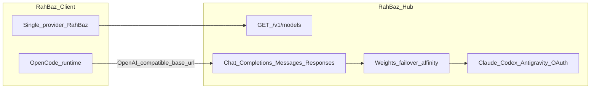

# RahBaz Architecture

## Product model

### RahBaz Hub

- Docker service `cliproxy` (upstream [CLIProxyAPI](https://github.com/router-for-me/CLIProxyAPI))
- Loopback API on `127.0.0.1:8317`
- Stores provider OAuth under `auths/`
- Exposes a unified model catalog and chat APIs (OpenAI / Claude / Codex compatible)
- Operator sets priority via credential `weight` and Hub routing config

### RahBaz Client

- Fork of [T3 Code](https://github.com/pingdotgg/t3code) (MIT) at `clients/rahbaz-client`
- Registers **one** driver: `rahbaz`
- Model picker is filled from Hub `GET /v1/models`
- Internally runs OpenCode locked to the Hub base URL + gateway API key
- Other stock providers (Claude, Codex, Cursor, Antigravity, …) are removed/hidden so the Client cannot bypass the Hub

### Optional: switch-notifier

- Sidecar on `:8791` for failover visibility
- Not required for the OpenRouter-style product path

## Trust boundary

- Provider OAuth tokens stay in Hub volume `auths/`
- Client only stores Hub base URL + gateway API key
- Hub ports published on `127.0.0.1` only

## Priority and failover

- Hub `routing.strategy: weighted-round-robin`
- Per-credential `"weight"` in `auths/*.json` (0 = drain)
- Session affinity keeps a thread on one credential until quota/auth forces rebind
- Pre-token failover via bootstrap retries / Codex stream bootstrap buffering
- Post-token failure: Hub errors; Client retries on next turn with rebound credential

## Fallback (legacy)

Stock T3 can still point Claude/Codex env vars at the Hub (see `clients/t3-presets`). That is **not** the primary product — the RahBaz Client is.
